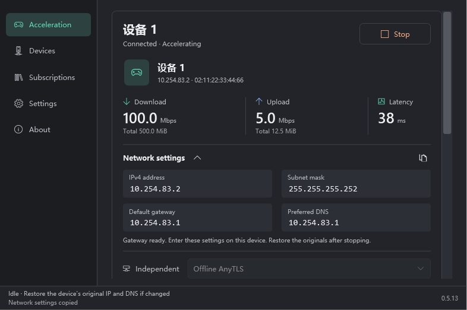
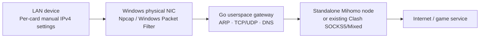

  

<h1 align="center">LAN Device Accelerator</h1>

Windows LAN gateway in side router mode · x64

<a href="README.md">简体中文</a> · <strong>English</strong>

  <a href="https://github.com/IMYC001/LAN-side-router-for-windows/releases/latest">Download</a> ·
  <a href="#quick-start">Quick start</a> ·
  <a href="docs/BUILDING.md">Build from source</a> ·
  <a href="https://github.com/IMYC001/LAN-side-router-for-windows/issues">Report an issue</a>

Use your Windows PC as a proxy gateway for devices on the same LAN. Forward their **IPv4 TCP/UDP** traffic through nodes in your existing Clash subscription. No client is required on the target device: start acceleration, enter the generated IP address, subnet mask, gateway and DNS, and the app detects it.

Current version: **0.5.13**. Designed around PS5 and other devices with manual IPv4 network settings; compatibility with additional models requires testing. No proxy service or subscription is provided. This project is not affiliated with NetEase UU.

> Screenshots are rendered by this version's offline UI checks. Connections, nodes, latency, throughput and quota are illustrative. The original user confirmed that the earlier throughput issue was resolved in 0.5.5; actual performance depends on the PC, LAN and node.

## Features

| Feature | Details |
| --- | --- |
| Same-LAN gateway | Generates settings when started; detects the connecting device without asking for its old IP or MAC |
| Independent devices | Separate names, start/stop controls, network parameters and counters; same or different nodes |
| Clash subscriptions | HTTPS or local YAML; subscription cards, updates, switching, deletion and provider quota |
| Independent exit | Bundled standalone Mihomo core; its own TUN is disabled; default mode |
| Existing Clash exit | Uses a local SOCKS5/Mixed endpoint; Clash must be in Global mode |
| Latency and traffic | Direct node latency, upload/download rates and session totals; not an in-game latency measurement |
| Appearance and language | Light/dark themes, five accents including Light Salmon, live Chinese/English switching |
| Local persistence | Subscriptions and preferences encrypted with Windows current-user DPAPI |

## Screenshots

### Multiple Devices

Adding a device creates an acceleration card automatically. Each card has its own node and start/stop control. User-supplied device names remain unchanged when switching language.

### Subscription Cards

Switch subscriptions, view the provider's reported usage and test node latency.

### Settings

Choose a theme, accent and language without restarting an active acceleration session.

Dark Light Salmon theme and About

## Downloads and Requirements

Get files from [Releases](https://github.com/IMYC001/LAN-side-router-for-windows/releases/latest).

| File | Purpose |
| --- | --- |
| `Accelerator-0.5.13-Setup-win-x64.exe` | Recommended; runtime, proxy core and complete vendor Windows Packet Filter installer |
| `Accelerator-0.5.13-win-x64.zip` | Folder distribution; extract everything and use an already installed supported driver |
| `SHA256SUMS.txt` | SHA-256 checksums |
| GitHub `Source code` | Full project source, not a ready-to-run application |

Requires **x64 Windows 10 2004 (19041) or later / Windows 11**, a shared LAN with device-to-device connectivity, and administrator consent for the forwarding helper. No separate .NET installation is required.

An installed **Npcap or Windows Packet Filter** backend is required. Setup reuses an existing backend; installing the bundled vendor driver requires your explicit agreement. **Driver installation or removal may briefly disconnect the PC or require a restart.** The app and setup executable are unsigned; Windows may show an unknown publisher. The bundled vendor driver MSI has been signature-verified.

## Quick Start

1. Install or extract the entire app folder. Connect the PC and target device to the same LAN. Record the device's original IP/DNS settings.
2. Import your own Clash subscription or local YAML on Subscriptions, test latency and select a node. UDP games require a UDP-capable node.
3. Keep the default Independent subscription mode, or select an existing Clash endpoint in Settings. For the latter, switch Clash to **Global mode** first.
4. Click Start on a device card and approve the helper. **Wait until that card says the gateway is ready**, then enter its IPv4 address, subnet mask, default gateway and DNS on that device.
5. Valid gateway traffic automatically connects the device. Add more devices under Devices and give each its own generated settings.
6. After stopping, exiting, sleeping, power loss or an error, **manually restore the original device IP/DNS settings**. Restore automatic addressing if that was the previous setting.

The app cannot remotely restore device settings. A stopped PC gateway cannot provide connectivity to a device still configured to use it. Only IPv4 is supported; usable public IPv6 may bypass this path, so review the target device's IPv6 configuration.

## How It Works

The gateway answers for its own virtual address, does not impersonate the real router and does not provide DHCP. The app does not change Windows IP addresses, default gateway, routes, DNS, firewall or host IP forwarding, and does not create another TUN. Installing a driver is a separate system operation.

Devices keep independent forwarding state. Adding or removing another device preserves existing device connections and counters. Stop files, UI heartbeats, adapter checks and status checks guard the helper lifecycle.

## FAQ

**Can it coexist with Clash TUN on the PC?**  
Independent mode uses its own loopback core and the selected physical interface, without another TUN. Environment-specific validation still matters. If using the existing Clash endpoint instead, use Global mode; Rule mode can allow some device traffic to go direct.

**Does it guarantee line speed, NAT Type 2 or lower latency in every game?**  
No. The original user confirmed the throughput fix and reported NAT Type 2 in a tested setup. Results depend on the node, LAN, driver and server. Full-cone behavior and arbitrary-source inbound connectivity are not implemented.

**Why does public ping time out?**  
Only IPv4 TCP/UDP is forwarded. Public ICMP is not forwarded; only the generated virtual default gateway answers ping. A failed public ping does not by itself prove game forwarding is broken.

**Why is node latency different from Clash or a game?**  
TCP-based nodes use direct TCP connect timing; Hysteria/Hysteria2/TUIC use ICMP. These differ from HTTP URL-tests and game paths. Existing Clash mode shows `--` when its remote node is unknown.

**Can I move saved subscriptions to another PC?**  
DPAPI data is bound to the Windows account and machine. Reimport subscriptions on a new PC. The folder package still needs an installed supported driver.

**What if importing a subscription fails?**  
Check the HTTPS URL, certificate trust and provider's client requirements, or import local YAML. Provider-only configurations, dialer chains and unsupported plugins cannot be used as standalone nodes; export concrete nodes or use the existing Clash endpoint.

## Documentation and Development

- [Building and validation / 构建](docs/BUILDING.md): pinned tools, layout, offline checks and setup packaging.
- [Installation and removal (Chinese)](docs/INSTALLATION.md): driver consent, shared drivers and uninstall behavior.
- [Windows portability](docs/PORTABILITY.md): drivers, account encryption and HTTPS compatibility.
- [Changelog](CHANGELOG.md) · [0.5.13 release notes](docs/releases/v0.5.13.md).
- [Contributing](CONTRIBUTING.md) · [Security and privacy](SECURITY.md).

The repository contains the WPF desktop, Go engine, installer, build scripts and test source. Builds fetch pinned tools and dependencies. Personal subscriptions, configuration, raw diagnostics, driver binaries and tool caches are excluded from Git.

## Licensing

Original project source is licensed under [GPL-3.0-only](LICENSE). Third-party components retain their respective licenses; see [THIRD-PARTY-NOTICES.md](THIRD-PARTY-NOTICES.md).

The standalone Mihomo core is GPLv3, with its license and pinned corresponding source included in application distributions. **The optional Windows Packet Filter vendor driver has a separate EULA and is not relicensed under GPL.** Complete copies and the EULA accompany setup; vendor restrictions on free/non-profit packaging and commercial redistribution still apply. Npcap is not redistributed.

## Contact and Thanks

Maintainer: **IMYC001** · QQ: **3524829413**  
Special thanks: **GPT 6 Astra**

Thanks to Mihomo, tun2socks, gVisor, Windows Packet Filter, Npcap, .NET, Go and the other upstream projects.
