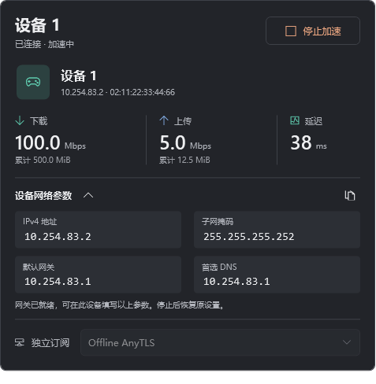
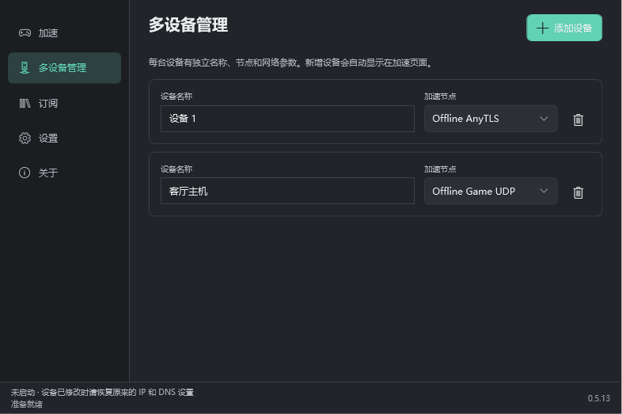
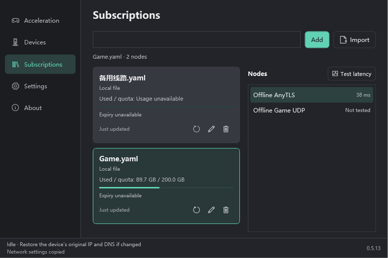
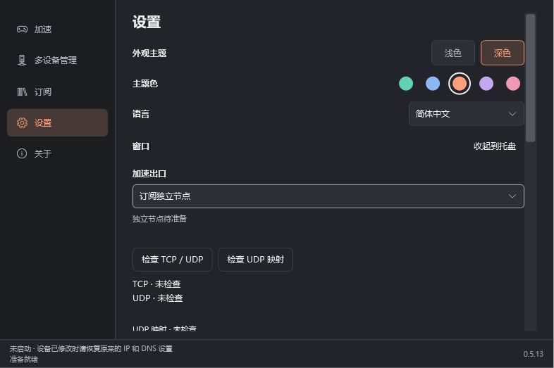
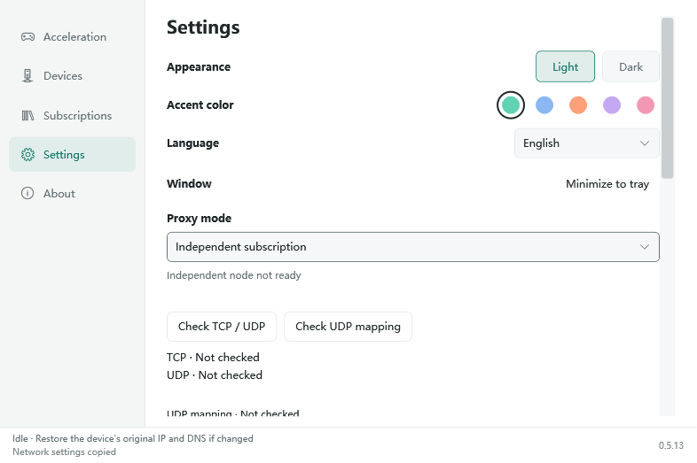
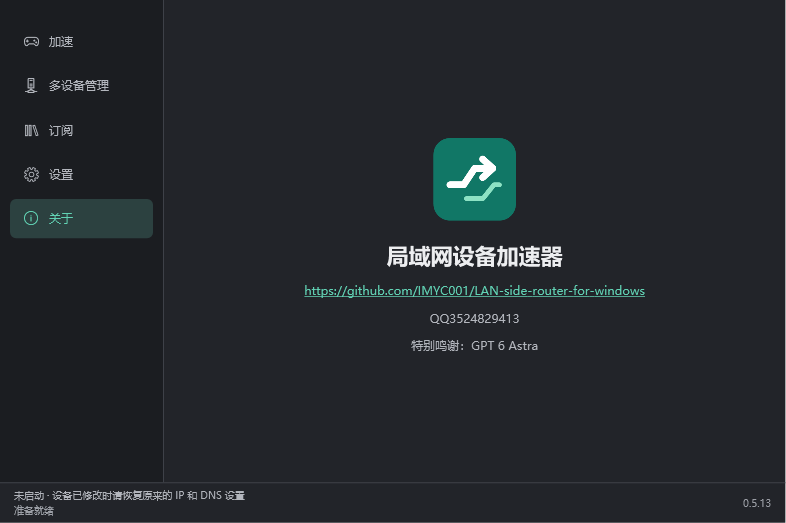

  

<h1 align="center">局域网设备加速器</h1>

局域网设备加速（旁路由模式） · Windows x64

<strong>简体中文</strong> · <a href="README.en.md">English</a>

  <a href="https://github.com/IMYC001/LAN-side-router-for-windows/releases/latest">下载最新版本</a> ·
  <a href="#快速开始">快速开始</a> ·
  <a href="docs/BUILDING.md">从源码构建</a> ·
  <a href="https://github.com/IMYC001/LAN-side-router-for-windows/issues">反馈问题</a>

把 Windows 电脑作为同一局域网内设备的代理网关，使用你已有的 Clash 订阅节点转发设备的 **IPv4 TCP/UDP** 流量。目标设备无需安装客户端：开始加速后，把软件生成的 IP、子网掩码、网关和 DNS 填入设备即可自动识别。

当前版本 **0.5.13**。适用于 PS5，以及允许手动配置上述 IPv4 参数的其他设备；其他型号的兼容性需要实际验证。软件不提供节点或订阅，也不是网易 UU 产品。

> 截图来自本版离线界面验证；节点、连接、延迟、速率和额度均为示例，不代表实际测速结果。用户已实测确认此前的转发速度问题在 0.5.5 得到解决，实际速度仍取决于电脑、局域网和节点。

## 功能

| 功能 | 说明 |
| --- | --- |
| 同局域网旁路由 | 无需设备原 IP/MAC；启动后生成参数，等待设备接入并自动绑定 |
| 多设备独立控制 | 每台设备独立命名、启停、网络参数、统计，可选相同或不同节点 |
| Clash 订阅 | HTTPS 链接或本地 YAML；多订阅卡片、更新、删除、切换、服务商额度 |
| 独立节点出口 | 内置独立 Mihomo 核心，自身不开 TUN，默认使用此模式 |
| Clash 共存出口 | 可用现有 SOCKS5/Mixed 入口；需将 Clash 切成全局模式 |
| 延迟与流量 | 节点直连延迟、实时上传下载、本次累计；节点延迟不等于游戏延迟 |
| 外观与语言 | 深浅主题、五种主题色（含浅鲑红）、简体中文 / English 即时切换 |
| 本地保存 | 当前 Windows 账户 DPAPI 加密保存订阅及设置，退出后保留 |

## 界面预览

### 多设备管理

新增设备自动显示为加速卡片，各自选择节点并独立启停。

### 订阅管理

以卡片切换订阅，查看服务商提供的用量及到期信息，并测试节点延迟。下图使用英文界面。

### 外观设置

主题、主题色、语言与托盘入口集中在设置页，运行中切换语言不会重启加速会话。

查看英文浅色界面及关于页

## 下载与要求

在 [Releases](https://github.com/IMYC001/LAN-side-router-for-windows/releases/latest) 下载：

| 文件 | 用途 |
| --- | --- |
| `Accelerator-0.5.13-Setup-win-x64.exe` | 推荐；包含运行时、核心及原厂 Windows Packet Filter 驱动安装包 |
| `Accelerator-0.5.13-win-x64.zip` | 文件夹版；必须解压全部文件，且电脑已安装受支持驱动 |
| `SHA256SUMS.txt` | 下载文件的 SHA-256 校验值 |
| GitHub `Source code` | 本项目完整源码，不是可直接运行的程序 |

要求 Windows 10 2004（19041）及以上或 Windows 11 **x64**，电脑和设备在同一局域网，且网络允许设备之间互通。无需另装 .NET；转发辅助进程需要管理员授权。

需要已有 **Npcap 或 Windows Packet Filter** 其中一种驱动。安装版优先复用现有驱动，只在缺少驱动并由你明确同意后安装原厂 Windows Packet Filter。**安装或卸载驱动可能短暂断网或要求重启**。软件及安装器未代码签名，Windows 可能显示未知发布者；内附原厂驱动 MSI 的签名已校验。

## 快速开始

1. 安装或完整解压软件，电脑与设备连接同一局域网。先记录设备原来的 IP/DNS 设置。
2. 在“订阅”导入自己的 Clash 订阅或本地 YAML，测试延迟并选节点。UDP 游戏需要节点支持 UDP。
3. 默认使用“订阅独立节点”。如在设置中改为 Clash 共存出口，先将 Clash 切为**全局模式**，检查本机 SOCKS5/Mixed 入口。
4. 在加速卡片点击“开始加速”，授权辅助进程。**等该卡片显示网关就绪**后，将卡片的 IPv4 地址、子网掩码、默认网关和 DNS 填到对应设备。
5. 设备发出有效网关请求后自动接入。需要多台设备时在“多设备管理”添加，每台使用自己的参数，不能共用一组。
6. 停止、退出、休眠、断电或异常结束后，**手动将设备 IP/DNS 恢复原设置**；原先自动获取则改回自动。

软件不能远程恢复设备网络设置；停止后继续使用手动网关，会导致该设备无法通过电脑联网。仅支持 IPv4；可用的公网 IPv6 可能绕过此加速路径，请在使用前确认设备的 IPv6 情况。

## 工作方式

网关仅回应自身虚拟地址，不冒用真实路由器，不提供 DHCP。应用不修改 Windows 的 IP、默认网关、路由、DNS、防火墙或系统 IP 转发，不创建第二个 TUN；驱动安装是独立的系统操作。

每台设备拥有独立转发状态和节点。增减另一台设备时保留原设备的连接及统计。停止文件、界面心跳、网卡变化和状态异常检查用于结束失去控制的转发。

## 常见问题

**能与电脑上的 Clash TUN 共存吗？**  
独立订阅模式使用自己的回环核心和所选物理网卡，不开第二个 TUN。共存效果仍取决于网络环境。如果改用现有 Clash 入口，需要全局模式；规则模式可能使部分设备流量直连。

**能保证全速、NAT 2 或降低所有游戏延迟吗？**  
不能。用户已反馈速度修复有效及某些场景 NAT 2，但带宽、UDP、NAT 与游戏体验取决于节点、网络、驱动及游戏服务器。软件不提供完整 full-cone 或任意来源入站。

**为什么公网 ping 超时？**  
当前仅转发 IPv4 TCP/UDP，公网 ICMP 不转发；只有软件提供的虚拟默认网关回应 ping。公网 ping 超时不能单独判断游戏转发失败。

**节点延迟为什么与 Clash 或游戏不同？**  
TCP 类节点测直连 TCP 建连耗时，Hysteria/Hysteria2/TUIC 测 ICMP；与 HTTP URL-test 和实际游戏路径不同。Clash 共存模式无法确认远端节点时显示 `--`。

**换电脑后订阅还在吗？**  
设置使用当前 Windows 账户 DPAPI 加密，不能跨电脑直接解密；另一台电脑首次需重新导入。文件夹版也需要受支持驱动，并非免驱。

**订阅导入失败怎么办？**  
检查 HTTPS 链接、证书信任和服务商是否允许此客户端，或导入本地 YAML。只有 provider、链式拨号或不支持插件的配置不能直接作为独立节点；可导出实际节点或使用 Clash 共存入口。

## 文档与开发

- [构建与验证 / Building](docs/BUILDING.md)：固定工具版本、源码结构、离线测试、安装包。
- [安装与卸载](docs/INSTALLATION.md)：驱动授权、共享驱动、卸载边界。
- [Windows 可移植性（English）](docs/PORTABILITY.md)：驱动需求、账户加密、HTTPS 兼容。
- [更新记录 / Changelog](CHANGELOG.md) · [0.5.13 Release 说明](docs/releases/v0.5.13.md)。
- [参与贡献 / Contributing](CONTRIBUTING.md) · [安全与隐私 / Security](SECURITY.md)。

仓库包含 WPF 桌面、Go 转发引擎、安装器、构建脚本和测试源码。构建会下载固定版本的工具与第三方依赖；个人配置、订阅、诊断原始数据、驱动二进制和工具缓存不进入 Git。

## 开源许可与第三方组件

本项目原创源码采用 [GPL-3.0-only](LICENSE) 开源。第三方组件保留各自许可，参见 [THIRD-PARTY-NOTICES.md](THIRD-PARTY-NOTICES.md)。

独立 Mihomo 核心以 GPLv3 提供，发布包附带其许可证和对应固定版本源码。**可选安装包内的 Windows Packet Filter 原厂驱动是单独许可的第三方软件，不因本项目开源而改用 GPL**；其完整副本和 EULA 随安装包提供，免费/非营利打包及商业分发限制以原厂 EULA 为准。Npcap 不随包分发。

## 联系与鸣谢

维护者：**IMYC001** · QQ：**3524829413**  
特别鸣谢：**GPT 6 Astra**

感谢 Mihomo、tun2socks、gVisor、Windows Packet Filter、Npcap、.NET、Go 及其他上游项目。
